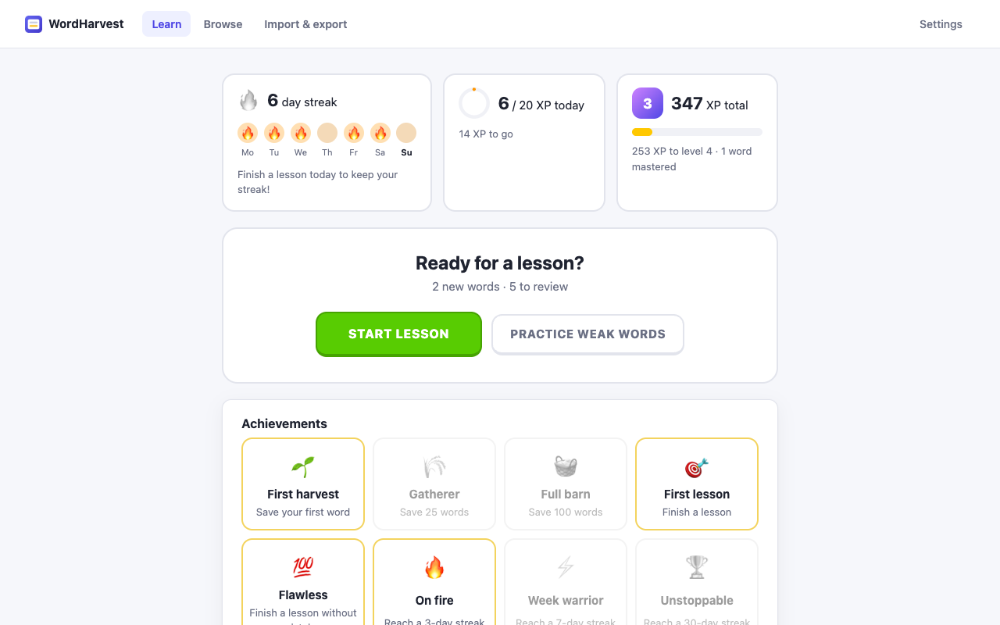
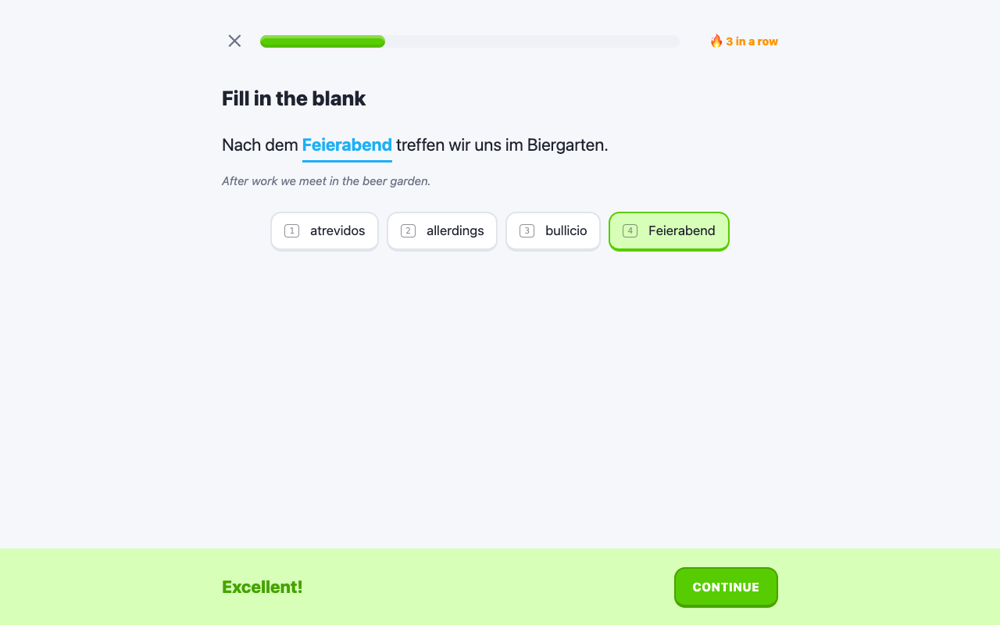
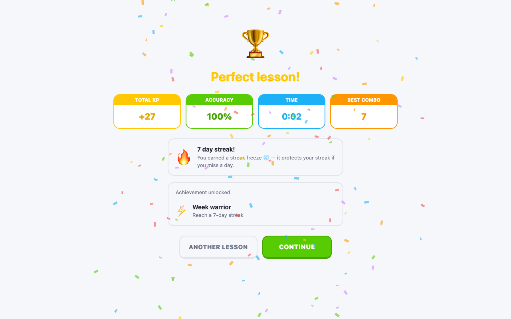
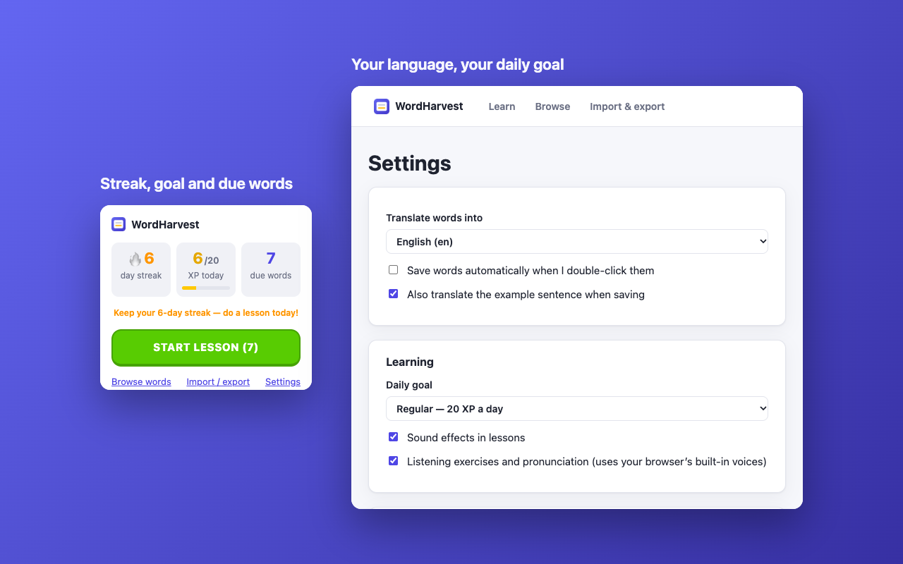

# WordHarvest: learn words while you read

A Chrome extension (Manifest V3) for picking up vocabulary from the pages you read, and keeping it with short, game-like lessons:

1. **Double-click a word** on any page. A popup shows its translation.
2. **Save** it, or turn on auto-save. The word is saved with the sentence it came from, the page title and the URL, and earns you XP.
3. **Learn** it in Duolingo-style lessons. The app checks your answers itself, and a spaced-repetition schedule (SM-2) decides when each word comes back.


| Learn | Lesson |
| --- | --- |
|  |  |
|  |  |

## Features

**Reading**
- The translation popup is rendered in a **closed Shadow DOM**, so page CSS can't change it and it can't change the page.
- **Sentence capture:** the extension finds the nearest block element around the word and splits its text into sentences on `. ! ? 。！？…` and similar marks, using the locale-aware `Intl.Segmenter` with a regex fallback.
- **No duplicates:** saving the same word again from another page adds the new sentence as another example on the existing word.
- **Translation:** uses Chrome's built-in **on-device Translator + Language Detector APIs** when they are available, and falls back to the free **MyMemory** API. No API keys are needed.
- **Language:** the source language is detected automatically, and you can change it in the popup. The target language is set on the options page (English by default).
- Double-clicks in inputs, textareas, selects and contenteditable areas are ignored.

**Learning**
- **Lessons** of about 10 exercises. Exercises get harder as you learn a word:
  1. **New word** card, then pick its meaning
  2. pick the meaning, or **listen** and pick it
  3. **fill in the blank** in the sentence you saved, choosing from word chips
  4. **type the missing word**; typos and missing accents count as nearly right
  5. **match the pairs** bonus round
- Wrong answers come back later in the same lesson.
- **Grading:** answers are checked automatically and feed the SM-2 schedule: wrong → *again*, typo → *hard*, right → *good*, typed right on a strong word → *easy*.
- **XP** for correct answers, combos (5+ in a row), finishing lessons, perfect lessons, and every new word you save.
- **Daily goal** (10 / 20 / 30 / 50 XP), **streak** with a 7-day calendar, and **streak freezes** (earned every 7 days; each saves your streak if you miss a day).
- **Levels**, **achievements** and **word strength** bars (new → mastered).
- **Practice mode** when nothing is due: uses your weakest words and earns XP without changing the schedule.
- Sound effects (synthesized, no audio files), confetti, and pronunciation through the browser's built-in voices. Each can be turned off.
- Keyboard: **1–4** to pick an answer, **Enter** to check and continue.

**Managing words**
- Browse, search, edit and delete saved words.
- **JSON / CSV export and import**, plus an **Anki-ready CSV** export.

## Install (development)

Requirements: Node.js ≥ 22.18 (Node 24 recommended) and Chrome.

```bash
npm ci
npm run build          # → dist/
```

1. Open `chrome://extensions`.
2. Turn on **Developer mode** (top right).
3. Click **Load unpacked** and select the **`dist/`** folder.

Open any article, double-click a word, and click **Save**. Click the toolbar icon to see your streak and start a lesson.

```bash
npm run watch          # rebuild on change, then click ↻ on the extension card in chrome://extensions
npm run typecheck
npm test               # unit tests: SM-2, exercises, streaks/XP, merging, CSV, sentence splitting, MyMemory parsing
npm run package        # typecheck + test + build + zip → release/wordharvest-<version>.zip
npm run store-assets   # regenerate icons, screenshots and promo tile (uses your installed Chrome)
```

## Usage

| Where | What |
| --- | --- |
| Any web page | Double-click a word to see the popup. **Save** saves the word (+1 XP). **Esc** or a click outside closes the popup. Use the language menu if the language was detected wrong. |
| Toolbar icon | Shows your streak, today's XP against your goal, and due words. **Start lesson** goes straight into a lesson. |
| Learn | Home: streak, daily goal, level and achievements. **Start lesson**, or **Practice weak words** when nothing is due. In a lesson: **1–4** pick, **Enter** check / continue, **Skip** if you don't know. |
| Browse | Search across words, translations and sentences. Bars show each word's strength. Click a word to edit it, delete it, or reset its progress. |
| Import & export | JSON (lossless), CSV (one row per example sentence), and Anki CSV export. JSON and CSV import merges into existing words. |
| Settings | Target language, auto-save, translating example sentences, daily goal, sound effects, listening exercises, translation provider, and an optional MyMemory e-mail for a higher free quota. |

**Importing into Anki (2.1.55+):** use *File → Import* and choose the exported `wordharvest-anki-*.csv`. The file's header lines set the separator, the HTML option and the tags column. Choose the **Basic** note type.

## Architecture

```
┌──────────────────────── web page (any http/https site) ────────────────────────┐
│  content script  (src/content/)                                                  │
│   dblclick → word + sentence → detect language → translate → popup (Shadow DOM)  │
│        │ on-device Translator / LanguageDetector run here (window-only APIs)     │
└────────┼─────────────────────────────────────────────────────────────────────────┘
         │ chrome.runtime.sendMessage  {translate | saveWord | completeLesson}
┌────────▼──────────── service worker (src/background/) ───────────┐
│  • remote translation proxy (MyMemory; the only network access)  │
│  • single, serialized writer for words + progress (XP, streak)   │
└────────┬─────────────────────────────────────────────────────────┘
         │ chrome.storage.local  (one key per card + "progress" + "settings")
┌────────▼──────────── extension pages (src/pages/) ─────────────────────────────┐
│  popup.html    streak, daily goal, due words + "Start lesson"                 │
│  review.html   #learn (home, lessons) · #browse (search/edit) · #data (import/export) │
│  options.html  settings                                                        │
└────────────────────────────────────────────────────────────────────────────────┘
```

- **Content script** (`src/content/`): listens for `dblclick`, ignores editable targets, and cleans the selection. It walks up to the nearest block element and builds that block's text. It then finds the sentence that contains the word, detects the language from that sentence (more reliable than from a single word), translates the word, and renders the popup. Chrome's on-device Translator and LanguageDetector APIs only exist in window contexts, not in service workers, so they run here.
- **Service worker** (`src/background/`): saves every word for the content script and records every finished lesson. It does one write at a time, so saves from several tabs and lesson results can't overwrite each other. It also awards XP, updates the streak and unlocks achievements. It also calls the remote translation provider. The service worker is the only place with a host permission for the translation API.
- **Pages** (`src/pages/`): plain TypeScript, no framework. `learn/home.ts` shows progress and starts lessons; `learn/lesson.ts` runs them (rendering, answer checking, rescheduling words, summary); `fx.ts` has sounds, speech and confetti. Pages write words directly and send lesson results to the service worker.
- **Shared logic** (`src/shared/`): pure functions with unit tests (`srs.ts` scheduling, `exercises.ts` lesson building and answer checking, `progress.ts` XP / streak / levels / achievements, `cards.ts`, `csv.ts`, `highlight.ts`) and thin storage wrappers (`storage.ts`, `settings.ts`).

Build: esbuild bundles each entry point (content script and pages as IIFE, service worker as ESM) into `dist/`, and copies `public/` (manifest, HTML, CSS, icons) next to them. The output is not minified, which makes Chrome Web Store reviews faster.

### Data model (`chrome.storage.local`)

```ts
// key: "card:<lang>:<lowercased term>"  e.g. "card:es:atrevidos"
interface Card {
  id: string;            // "es:atrevidos". Saving the same word again merges into this card.
  term: string;          // as clicked
  lang: string;          // detected source language (BCP 47)
  translation: string;
  notes?: string;
  examples: {            // one per sentence the word was saved from
    sentence: string; word: string; translation?: string;
    url: string; title: string; addedAt: number;
  }[];
  srs: { due: number; interval: number; ease: number; reps: number; lapses: number; lastReviewed?: number };
  createdAt: number; updatedAt: number;
}
// key: "progress"
interface Progress {
  xp: number;
  dailyXp: Record<string, number>;   // "YYYY-MM-DD" → XP (last 90 days)
  streak: { current: number; longest: number; lastDay: string | null; freezes: number };
  lessons: number; perfectLessons: number;
  achievements: Record<string, number>;   // id → unlock time
}
// key: "settings" → { targetLang, autoSave, translateSentences, provider: "auto"|"builtin"|"remote",
//                     myMemoryEmail, dailyGoal, soundEffects, listening }
```

Each card has its own key, so saving a word writes about 1 KB instead of rewriting the whole collection. `chrome.storage.local` holds 10 MB, which is roughly 10,000 cards with a few example sentences each. If you need more, add the `unlimitedStorage` permission or move to IndexedDB. Only `src/shared/storage.ts` would need to change.

## Translation providers

The flow is in `src/translate/index.ts`:

| Setting | Provider chain |
| --- | --- |
| **Automatic** (default) | Chrome on-device translator **if its model is already downloaded**, otherwise MyMemory. In the second case the model download starts in the background for next time, so you never wait for it. |
| **On-device only** | Chrome on-device translator only. It waits for the model download if needed. Nothing leaves the browser. |
| **Online only** | MyMemory only. |

Language detection tries Chrome's on-device `LanguageDetector` first, then `chrome.i18n.detectLanguage`, then the page's `lang` attribute.

### Changing the translation provider

All providers implement one interface (`src/translate/types.ts`):

```ts
interface TranslationProvider {
  readonly id: string;
  readonly label: string;
  canTranslate(source: string, target: string): Promise<boolean>;
  translate(text: string, source: string, target: string): Promise<string>;
}
```

To replace MyMemory with another service, for example LibreTranslate:

1. Create `src/translate/libretranslate.ts`:

   ```ts
   import type { TranslationProvider } from './types.ts';
   import { TranslationError } from './types.ts';

   export function createLibreTranslateProvider(endpoint: string, apiKey?: string): TranslationProvider {
     return {
       id: 'libretranslate',
       label: 'LibreTranslate',
       canTranslate: async () => true,
       async translate(text, source, target) {
         const res = await fetch(`${endpoint}/translate`, {
           method: 'POST',
           headers: { 'Content-Type': 'application/json' },
           body: JSON.stringify({ q: text, source, target, format: 'text', api_key: apiKey }),
         });
         if (!res.ok) throw new TranslationError(`LibreTranslate error (HTTP ${res.status})`);
         return (await res.json()).translatedText;
       },
     };
   }
   ```

2. Return it from `createRemoteProvider()` in `src/translate/registry.ts`.
3. Replace the MyMemory origin in `host_permissions` in `public/manifest.json` with the new API's origin, and update `store/privacy-policy.md` and `store/permissions-justification.md`.

To add a provider that runs in the page instead, such as another on-device API, add it to `providerChain()` in `src/translate/index.ts`.

## Permissions

The extension requests only these permissions. The store-ready wording is in [`store/permissions-justification.md`](store/permissions-justification.md).

| Permission | Why |
| --- | --- |
| `storage` | Saves cards and settings locally in `chrome.storage.local`. |
| Content script on `http://*/*`, `https://*/*` | The core feature, double-clicking a word on any page, needs the content script on every page. It doesn't run on `file://` or `chrome://` pages. |
| `https://api.mymemory.translated.net/*` | Lets the service worker call the fallback translation API, and no other origin. |

The extension deliberately does **not** request these:

- `tabs`: `chrome.tabs.create` works without it.
- `activeTab`/`scripting`: the content script is declared statically.
- `contextMenus`, `alarms` or `unlimitedStorage`.

## Privacy

Everything is stored locally. Text is sent to MyMemory only when the online fallback is used, and only the word or sentence being translated. See [`store/privacy-policy.md`](store/privacy-policy.md), published at https://talipturkmen.github.io/wordharvest/privacy-policy/.

## Releasing a new version

1. Bump `"version"` in **`public/manifest.json`** and commit.
2. Tag and push:

   ```bash
   git tag v1.1.0
   git push origin main v1.1.0
   ```

3. [`.github/workflows/release.yml`](.github/workflows/release.yml) then:
   - checks that the tag matches the manifest version
   - typechecks, tests and builds, and creates `wordharvest-<version>.zip`
   - attaches the zip to a **GitHub Release**
   - uploads and publishes to the **Chrome Web Store**. This step is skipped with a notice if the `CWS_*` secrets aren't set.

Setting up the store account, the first manual upload, and the OAuth credentials for CI are covered step by step in [`store/PUBLISHING.md`](store/PUBLISHING.md).

## Project layout

```
public/            manifest.json, HTML pages, styles.css, icons/
src/content/       content script: double-click handling, sentence capture, Shadow-DOM popup
src/background/    service worker: serialized saves, remote translation proxy
src/translate/     provider interface, Chrome on-device provider, MyMemory, registry, chain
src/shared/        types, SM-2 scheduler, exercises, progress/XP/streaks, card merge/validation, CSV/Anki, storage, settings
src/pages/         toolbar popup, learn (home + lessons), browse, import/export, options page
test/              unit tests (node --test)
scripts/           build, zip, store-asset generation (headless Chrome + mocked chrome.* API)
store/             listing, privacy policy, permission answers, publishing guide, images
.github/workflows/ CI, tag release (+ Chrome Web Store), GitHub Pages for the privacy policy
```

## License

[MIT](LICENSE)
